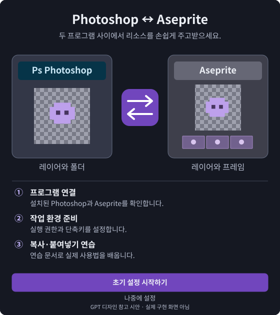
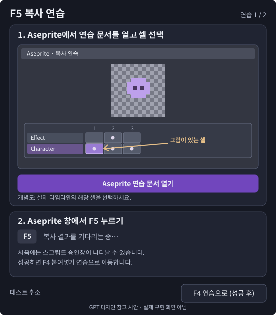
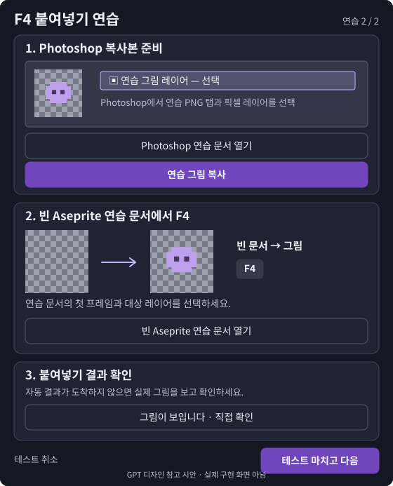

# (1) Photoshop ↔ Aseprite — 초기 설정 및 실습 UX 참고 시안

2026-11-26 · 사용자 승인 후 ChatGPT가 직접 등록한 **디자인 참고 자료**. 기준 제품 소스 [1c98d9d](https://github.com/rodetoast/PS2ASE/commit/1c98d9d523538cde6fb14418324aef33fbece490). 실제 Windows 구현 화면, 테스트 증거, 배포 파일이 아니다. 대화에서 제안한 개념도를 SVG/HTML로 재구성했으며 픽셀 단위 복제는 아니다.

## 시안 갤러리

| 시안 | 파일 | 구현 목적 |
|---|---|---|
| 초기 설정 소개 | [welcome-screen.svg](welcome-screen.svg) | 두 프로그램 사이의 전송을 그림으로 설명 |
| Photoshop 경고 | [photoshop-warning.svg](photoshop-warning.svg) | 저장된 값, 변경 선택, 실제 관찰 분리 |
| Aseprite 승인 | [aseprite-approval.svg](aseprite-approval.svg) | 승인 절차를 F5/F4 실습과 통합 |
| F5 복사 | [f5-copy-practice.svg](f5-copy-practice.svg) | 실제 셀 위치와 실행 순서 |
| F4 붙여넣기 | [f4-paste-practice.svg](f4-paste-practice.svg) | 전용 원본 복사, 빈 대상, 결과 확인 |
| 사용 방법 | [usage-tutorial.html](usage-tutorial.html), [usage-transfer.svg](usage-transfer.svg) | 기능별 시각적 안내 |
| 정렬 | [remember-alignment.svg](remember-alignment.svg) | 메인 창에서 기억 여부 설정 |

## 구현 의도 및 필수 동작

- 기존 PySide6 Widgets, Pretendard Variable, 배경 #151822, 패널 #202432, 강조 #7146bd를 유지한다. SVG의 고정 좌표는 시각 참고용으로 실제 Qt 레이아웃은 가변 크기, 100~200% DPI, 한·영·일 번역 및 스크롤을 지원한다. 버튼·텍스트는 실제 접근 가능한 위젯으로 구현한다.
- 시작 화면은 EXE 스플래시가 아닌 가이드 첫 페이지. 그림은 양방향 전송을 설명하고 애니메이션 시청은 강제하지 않는다. 기존 설정 숨기기 및 건너뛰기 선택은 유지한다.
- 경고 켜기/끄기와 저장된 현재 값은 제품 카드에서 명확히 보인다. 실행 여부와 설정 파일 값은 분리한다. 실제 적용 미확인이라는 고정 문구를 완료 조건처럼 표시하지 않는다. 실제 승인창 관찰은 사용자 확인이며 스크립트 성공으로 추정하지 않는다. 모든 Photoshop 종료, 명시적 동의, 대상 버전, 백업, 재시작 및 외부 JSX 전체 영향 안내는 유지한다.
- Aseprite는 명시적 설치/업데이트 및 충돌 보호를 유지한다. 별도 Trust 시험용 문서와 F5 문서가 동일한 파일명 규칙을 사용해 결과가 조용히 소비되는 문제를 보완한다. 권한 승인은 실제 F5/F4 연습에 통합하고 File > Scripts 수동 절차는 도움이 필요한 경우 제공한다. 기존 승인 기록을 실제 승인으로 간주하거나 초기화하지 않는다.
- F5 연습은 Aseprite 실행 → 지정 문서 열기 → 그림이 있는 타임라인 셀 선택 → F5 → 결과 확인. 문서 생성 시점부터 고유 세션의 결과를 안전하게 관찰할 수 있으면 별도 준비 완료 버튼을 제거한다. 그렇지 않으면 준비 완료 단계를 안내와 정확히 일치시킨다. 시안의 타임라인은 개념도이며 실제 위치는 호스트 캡처/정확한 도식으로 검증한다.
- F4 연습은 지정 Photoshop 원본을 열고 픽셀 레이어 선택 → 가이드에서 복사 → 전용 빈 Aseprite 문서 열기 → 대상 셀 선택 → F4 → 결과 확인. 일반 작업용 클립보드·미리보기·Undo/Redo 이력 격리, 문서/세션 토큰 보호, 만료 및 재시도 처리를 유지한다. 자동 결과가 오면 수동 확인을 요구하지 않는다. 자동 결과 수신과 실제 화면 직접 확인은 구분한다. 다른 업무 문서에 자동으로 붙여넣지 않는다.
- 연습 파일은 용도별로 식별 가능하게 표시한다. 직접 열기 가능 여부는 호스트 안전 조건에 따라 결정하며, 실패/실행 중에는 정확한 파일을 탐색기에서 선택하는 대체 행동을 제공한다. 사용자 제공 .aseprite 파일은 아직 제공되지 않았으므로 합성 자료로 먼저 구현 가능. 향후 여러 레이어와 프레임을 가진 공개 가능한 예제를 포함할 수 있도록 설계한다. 내부 UUID는 세션 식별에만 사용하고 실제 문서 식별 계약을 보존한다.
- 사용 방법 HTML은 구조와 동작 설명을 전달하는 브라우저용 참고이며 Qt에서 그대로 HTML을 사용하거나 기술 스택을 변경하라는 요구가 아니다. 기존 프레임/정렬 OptionDiagram을 재사용한다. 실제 호스트의 레이어·셀 위치, 복사/붙여넣기 버튼과 편집 결과를 정확한 캡처 또는 그림으로 보강한다. 텍스트 화살표만으로 시각 자료를 대체하지 않는다.
- 정렬 기억하기는 기존 마이그레이션 및 설정값을 보존한다. 체크 시 현재/이후 선택을 저장하고 해제 시 다음 실행에서 기본 바닥선 기준을 사용한다. 환경 설정의 경로 재탐색, 수동 선택 시작 위치 및 같은 세션의 테스트 상태 공유를 보존한다.
- 기존 가이드를 숨긴 사용자에게 스크립트 업데이트 필요를 메인 창에서 명확히 알려준다. 성공 콘솔 제거 및 일반 클립보드 오류 방어를 보존하고 개발 PC 전용 경로 fallback, 오래된 승인 기록, 결과 미수신/잘못된 문서 및 만료 처리를 점검한다.
- 완료 검토는 실제 호스트 연습 흐름, 대표 화면과 실패·복구 상태를 docs/ui-reviews/에 기록하고 이 시안과 비교한다. 실제 호스트 화면/승인창과 합성 시안을 구분한다. 기존 운영 0.3.6 및 0.3.7-rc1 보존; 새 빌드나 배포는 별도 승인. 

## 범위

이번 커밋은 디자인 자료만 추가한다. 실제 제품 소스, 설치본, 운영 카탈로그는 변경하지 않는다. 기존 장문 사용자 피드백과 후속 버그 수정 지시를 대체하지 않고 함께 적용한다. 사용자 원본 캡처나 개인정보는 등록하지 않았다.
